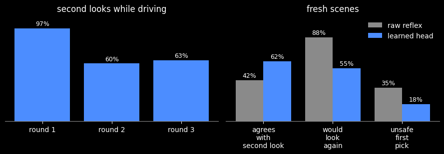

# Second Thought

[English](#second-thought) · [한국어](#한국어)

A toy self-driving car decides every move with **one Zoro-1 decision call**. When it is unsure, it takes a
**second look**: it simulates each move 4 seconds ahead and asks Zoro-1 again with those futures in front of it.
Every second look becomes a free training label, and a tiny head (60 numbers, trained on the CPU in about a second)
learns from them. After one round of learning the car needs far fewer second looks (97% of scenes in round 1,
about 60% after). One notebook, no labels from people.



<sub>From one run against the real Zoro-1 (SGLang decision server on a Colab T4 GPU). 40 fresh scenes: the learned
head agrees with the second look 62% of the time (raw reflex 42%), would need a second look
55% of the time (raw 88%), and picks an unsafe move first 18% of the time (raw 35%).
A small sample: expect a few points of difference from run to run.</sub>

**Who it's for:** people new to Zoro-1 who want to see what calibrated probabilities are good for beyond picking an
answer: deciding *when* to think harder, and turning those moments into training data. Useful if you are building
an agent that mixes a fast decision with a slow check (a System 1 / System 2 split).

It grew out of a TRILLION AGENT AI HACKATHON 2026 project, cut down to one idea you can run on a laptop.

## How it uses Zoro-1

Two kinds of `POST /v1/systemone` calls, both `"reasoning": false`:

| call | questions | used for |
|---|---|---|
| **reflex**, one per scene | `move`: `choice` over 5 moves; `danger`, `stop_ahead`, `lead_slow`, `left_free`, `gentle`, `hurry`: six `noul` checks, all on one prefill | the move probabilities are the reflex; all 11 numbers are the learned head's input |
| **second look**, only when unsure | `plan`: `choice` over the moves that passed the physics check, each described by its simulated 4 s future | the pick is the training label: physics keeps it safe, Zoro-1 reads what the passenger said |

The reflex request (trimmed to three of the seven questions):

```jsonc
{"model": "zoro-1", "reasoning": false,
 "state": {"road": "two-lane city street, you drive in the right lane", "speed_limit_kmh": 50,
           "your_speed_kmh": 49,
           "car_ahead": {"distance_m": 11, "speed_kmh": 41, "brake_lights": "on"},
           "left_lane": "free", "ahead": {"traffic_light": "red", "distance_m": 27},
           "passenger_says": "I'm feeling carsick, please drive smoothly."},
 "questions": {
   "move": {"type": "choice",
            "instructions": "Pick the driving move for the next 2 seconds. Avoiding a crash comes first, traffic rules second, then what the passenger wants.",
            "criteria": {"keep": "hold the current speed", "speed_up": "speed up gently (+1.5 m/s2)",
                         "ease_off": "slow down gently (-2 m/s2)", "brake": "brake hard (-6 m/s2)",
                         "change_left": "change to the left lane"}},
   "stop_ahead": {"type": "noul", "instructions": "Is there a red or yellow light, or a crossing pedestrian, that the car must stop for?"},
   "gentle": {"type": "noul", "instructions": "Does the passenger want a gentle, smooth ride?"}}}
```

What we saw with the real model: the yes/no checks are sharp (a red light ahead: `stop_ahead` 1.00; a carsick
passenger: `gentle` 1.00), while the one-shot move pick is often unsure or unsafe (on that scene: `ease_off` 0.42,
`keep` 0.32, `brake` 0.18). The learned head is a softmax regression that starts as an exact copy of the raw reflex
and learns how to combine the move probabilities with the checks. It never sees the road itself, only Zoro-1's
answers.

## Where it sits

- **`reasoning: "auto"`** already escalates when the top probability is low: decide first, reason only if unsure.
  This demo starts from the same idea and adds the other half: the second looks are kept as labels, so the car
  needs fewer of them over time instead of thinking just as often forever.
- **The method is not new.** Using a slow, careful answer to train a fast one is the pattern of AlphaZero (search
  results train the policy network), STaR / expert iteration, and "distilling System 2 into System 1". The demo is a
  small, runnable instance of it on Zoro-1's decision head.
- **This is not fine-tuning.** The `/v1/systemone` API returns answers, not hidden states, and has no way to load a
  new head, so the learned head sits on top of Zoro-1's output probabilities and Zoro-1's weights never change.
  The hackathon version did fine-tune: a patched server exposed the decision head's input hidden states, the head
  was retrained on the labels (backbone frozen), and the new head was swapped in live after a canary check. On real
  dashcam drives (comma2k19, label: did the driver brake hard within 3 s), 5-fold cross-validation over 176 drives
  raised the hazard AUC from 0.70 to 0.82 (drive-level 95% interval of the gain: +0.10 to +0.15). It also cost a little general
  decision accuracy, so a retrained head is not free.

## Run

Start Zoro-1 ([Run Zoro-1](../README.md#run-zoro-1)), then open `second_thought.ipynb` and run all cells. It talks
to `ZORO_URL` (default `http://127.0.0.1:8080`). Without a model, set `MOCK = True` in the setup cell (or
`ZORO_MOCK=1`): the mock is a made-up driver that ignores the passenger, and its numbers are fake.

```sh
cd demo/zoro-1/second-thought
uv run --no-project --with jupyter --with httpx --with matplotlib jupyter lab second_thought.ipynb
```

- **Speed:** the first cells show one scene, its reflex probabilities and its second look within seconds. The
  whole notebook makes about 240 decision calls. Against a GPU (SGLang batches) set `ZORO_CONCURRENCY=4`
  or more; keep 1 for the Mac MLX server. On a Colab T4 it took about 8.5 minutes; for a quicker look, lower
  `SCENES_PER_ROUND` and `TEST_SCENES` in the setup cell.
- **Colab:** a Colab notebook can't reach a Zoro-1 server on your own computer. Either run the server in the same
  Colab runtime (we did, on a T4: SGLang 0.5.23 in a Python 3.12 venv, with `SGLANG_MAMBA_CONV_DTYPE=float16`
  because the T4 has no bfloat16), or use mock mode. Anyone with a tunnel URL you put in `ZORO_URL` can use your
  server too.
- The outputs saved in the notebook are from one real run (see the first cell).

## Test

`test_second_thought.py` runs the notebook's own code in mock mode (no model, no network): the physics checks, the
learned head starting as an exact copy of the reflex, second-look labels always being safe, every request body
passing Zoro-1's parser, and the whole notebook with its check cell.

```sh
cd demo/zoro-1/second-thought
PYTHONPATH=../../../inference/zoro-1 uv run --no-project --with pytest --with httpx --with matplotlib pytest -q
```

The notebook must also run top to bottom in mock mode; its last cell checks the results:

```sh
ZORO_MOCK=1 uv run --no-project --with jupyter --with httpx --with matplotlib jupyter nbconvert --to notebook --execute second_thought.ipynb --output /tmp/out.ipynb
```

| file | what |
|---|---|
| `second_thought.ipynb` | the demo (outputs from one real run) |
| `test_second_thought.py` | mock-mode tests, including Zoro-1's request parser |
| `docs/result.png` | the chart above |

---

## 한국어

장난감 자율주행차가 매 순간 **Zoro-1 판단 호출 한 번**(반사)으로 움직입니다. 확신이 낮거나 고른 행동이 물리
검사에 걸리면 **다시 생각**합니다. 모든 행동을 4초 앞까지 시뮬레이션하고, 안전한 미래들만 보여 주며 Zoro-1에게
다시 묻습니다. 다시 생각한 결과는 그대로 학습 정답이 됩니다. 사람이 정답을 달 필요가 없습니다. 이 정답으로
작은 헤드(숫자 60개, CPU에서 약 1초)를 학습하면, 다시 생각하는 비율이 1라운드 97%에서 그 뒤 60% 안팎으로 줄어듭니다.

- **반사:** 한 요청에 질문 7개(행동 `choice` 1개, 예/아니오 `noul` 6개)를 묶어 보냅니다. 상태는 한 번만 읽습니다.
- **다시 생각:** 물리 검사를 통과한 행동들을 "4초 동안 31 m 이동, 22 km/h로 끝남, 부드러운 감속" 같은 미래로
  설명하고, 승객 말에 가장 맞는 것을 고르게 합니다.
- **학습한 헤드:** Zoro-1의 답 11개(행동 확률 5개 + 예/아니오 6개)만 읽습니다. 원본 반사와 똑같이 시작해서
  둘을 어떻게 섞을지 배웁니다.
- **실제 결과 (Colab T4, 새 장면 40개):** 다시 생각과 일치 42% → 62%, 다시 생각 필요
  88% → 55%, 첫 선택이 위험 35% → 18%. 표본이 작아서 실행마다 몇 %p씩 달라집니다.
- **대상:** Zoro-1을 처음 보는 사람 중, 보정된 확률을 "답 고르기" 너머로 쓰고 싶은 사람. 빠른 판단과 느린 확인을 섞는
  에이전트(System 1 / System 2)를 만드는 사람에게 특히 맞습니다.
- **테스트:** `test_second_thought.py`가 mock 모드로 노트북 코드를 그대로 실행해 물리 검사, 요청 형식(Zoro-1 파서),
  노트북 전체 실행을 확인합니다.
- **실행:** Zoro-1 서버를 띄우고 노트북을 위에서부터 실행합니다. 모델이 없으면 `ZORO_MOCK=1`로 가짜 답을 씁니다.
  GPU 서버라면 `ZORO_CONCURRENCY=4`를 권합니다.

- **선행 기능과 연구:** Zoro-1의 `reasoning: "auto"`도 확신이 낮을 때만 생각합니다. 이 데모는 거기에 "다시 생각한
  결과를 학습해서 다음엔 덜 생각하기"를 더했습니다. 느린 답으로 빠른 판단을 학습하는 방법 자체는 AlphaZero,
  STaR, System 2 → System 1 증류와 같은 갈래입니다.
- **파인튜닝이 아닙니다:** 공개 API는 답만 돌려주고 은닉 상태나 헤드 교체를 지원하지 않습니다. 그래서 작은 헤드를
  Zoro-1 출력 확률 위에 따로 학습합니다. Zoro-1 가중치는 바뀌지 않습니다. 해커톤 버전은 서버를 고쳐 판단 헤드를
  직접 재학습했고, 실제 주행 영상(주행 176개, 5분할 교차 검증)에서 위험 구분 AUC가 0.70에서 0.82로 올랐습니다. 대신 일반 판단
  정확도가 조금 떨어졌습니다.

TRILLION AGENT AI HACKATHON 2026 출품작 "Second Thought"를 노트북 하나로 줄인 데모입니다.
