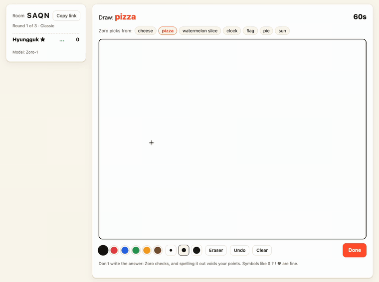

# Zoro Draw

A multiplayer drawing game in the browser. Everyone draws, and **Zoro-1 guesses**. Your score is the probability
Zoro-1 puts on the right answer, so a clear drawing beats a lucky one.



<sub>One round against the real Zoro-1 (MLX server on a Mac); the drawing part is sped up 2×.</sub>

## How it uses Zoro-1

Every drawing is one call to the **decision head** (`POST /v1/systemone`) with the drawing as the image and two
questions that share one prefill:

| question | type | used for |
|---|---|---|
| `guess` | `choice` over the candidate answers | the probability on each answer = your score |
| `has_text` | `noul` (yes/no): "did the player write out the answer?" | spelling the answer voids the drawing (P > 0.85); symbols like `$ ? ! ♥` are fine |

```jsonc
{"model": "zoro-1",
 "state": {"game": "A drawing game. A player drew a picture of one word…"},
 "images": ["data:image/png;base64,…"],            // 448×336, white background
 "questions": {
   "guess":    {"type": "choice", "instructions": "Which word is the drawing meant to show?",
                "criteria": {"lighthouse": "", "candle": "", "rocket": "", "…": ""}},
   "has_text": {"type": "noul", "instructions": "Did the player write out the answer (or part of it) as text…?",
                "criteria": {"true": "yes: words or letters spelling out an answer…",
                             "false": "no: only pictures, possibly with symbols such as $, ?, !, arrows, hearts…"}}},
 "max_image_pixels": 200704, "reasoning": false}
```

The answer has calibrated probabilities (`answers.guess.probabilities`), which is what makes the score fair and
the reveal fun. For Korean cards each option also carries an English description of the picture
(`"고래 싸움에 새우 등 터진다": "two whales fighting while a small shrimp between them gets crushed"`), so Zoro-1
judges what the drawing shows rather than how well it reads Korean.

## How to play

1. Open the page, enter a name and **Create a room**. Share the link (`/?room=CODE`) with friends.
2. The host picks a **mode**, a **deck** and the timers, then presses Start.
3. Draw. Don't write the answer: Zoro-1 checks. Symbols like `$ ? ! ♥` are fine.
4. The reveal shows each drawing with Zoro-1's probability for every candidate.

**Modes**

- **Classic.** Everyone draws the same word. Zoro-1 picks from the word and 6 lookalikes, which the drawers can
  see. Score = 100 × P(word); the best drawing of the round gets +20.
- **Decoy.** Everyone draws a different secret word. Then everyone writes a fake answer for each of the others'
  drawings. Zoro-1 picks from the word, 3 card decoys and the players' decoys. The drawer scores 100 × P(word),
  each decoy author scores 100 × P(their decoy), and writing the real word earns a +30 "sharp eye" bonus.

**Decks** (`zoro_draw/cards.py`)

| deck | cards | decoys |
|---|---|---|
| Words | 40 English words (lighthouse, jellyfish, …) | hand-picked lookalikes |
| 한국어 속담 | 31 proverbs: draw the literal picture (고래 싸움에 새우 등 터진다, 우물 안 개구리, …) | other proverbs |
| 한국 밈 · 신조어 | 23 (얼죽아, 오운완, 중꺾마, 깻잎 논쟁, …) | others from the deck |
| Internet memes | 21 (this is fine, distracted boyfriend, stonks, …) | others from the deck |
| Mix | a random deck each round | |

Proverbs take longer to draw: set the draw time to 90 s for those.

## Run

You need [uv](https://docs.astral.sh/uv/). Start Zoro-1 first (see [Run Zoro-1](../README.md#run-zoro-1)), then:

```sh
cd demo/zoro-1/zoro-draw
uv run zoro-draw --model-url http://127.0.0.1:8080 --concurrency 1   # Zoro-1 on your Mac (MLX server)
uv run zoro-draw --model-url http://127.0.0.1:30001                  # Zoro-1 on a GPU (serve_decide.py)
uv run zoro-draw --mock                                              # no model: deterministic fake guesses
```

Open http://localhost:8765. At startup it prints `Zoro-1 server OK` or a warning if it can't reach the model.

- **Play with others on the same network:** share `http://<your IP>:8765/?room=CODE`.
- **Play with anyone:** `cloudflared tunnel --url http://localhost:8765` and share the `https://….trycloudflare.com`
  link it prints, with `/?room=CODE` added.
- Expose only this app, never the Zoro-1 port: run Zoro-1 on localhost (`--host 127.0.0.1`, see
  [Run Zoro-1](../README.md#run-zoro-1)), or reach a GPU machine through an SSH tunnel. The page never gets the model
  server's URL or its error messages (those go to this app's log), and in Decoy mode players never see each
  other's words before the reveal.
- A round waits at most `--timeout` seconds (default 90) for Zoro-1; drawings it hasn't judged by then are shown
  as not judged, so a slow or stuck model can't hold a room.
- On the MLX server drawings are judged one at a time (`--concurrency 1`); with many players or rooms, serve
  Zoro-1 with SGLang (`serve_decide.py`), which batches them.

## Files

| file | what |
|---|---|
| `zoro_draw/judge.py` | the `/v1/systemone` request, response parsing, mock mode |
| `zoro_draw/game.py` | room state machine and scoring (no networking) |
| `zoro_draw/cards.py` | decks: words + lookalikes, 속담, 한국 밈, internet memes (with English descriptions) |
| `zoro_draw/server.py` | FastAPI app: page, websocket, phase timers, `/api/health` |
| `zoro_draw/static/` | the page: canvas, lobby, reveal |
| `tests/` | game logic, websocket flow, and a check that requests pass Zoro-1's own request parser |

The browser sends a 448×336 PNG on a white background (a transparent canvas reads as black), under the model's
448×448 image cap. Classic mode shuffles the candidates once per round, so every player is scored on the same
option order.

## Test

```sh
uv run --extra test pytest -q
PYTHONPATH=../../../inference/zoro-1 uv run --extra test pytest -q   # also checks requests against Zoro-1's parser
```

## Ideas

- More decks (movies by plot, emoji combos, Korean food) — a deck is a dict in `cards.py`.
- A Zoro-1 "commentator" that describes each drawing with `/v1/chat/completions` during the reveal.
- Rooms live in one process's memory. Use Redis and sticky sessions before running several instances.
